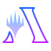
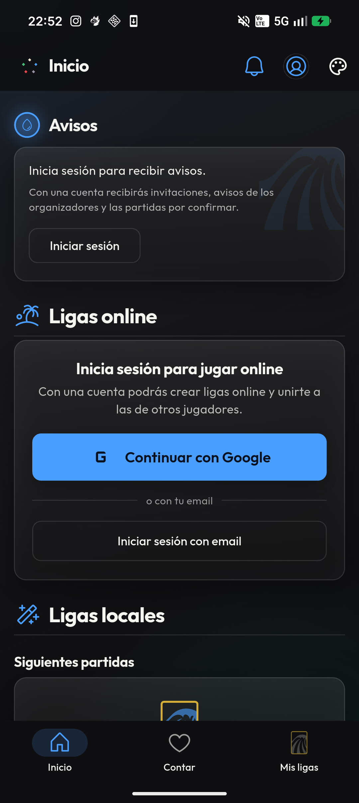
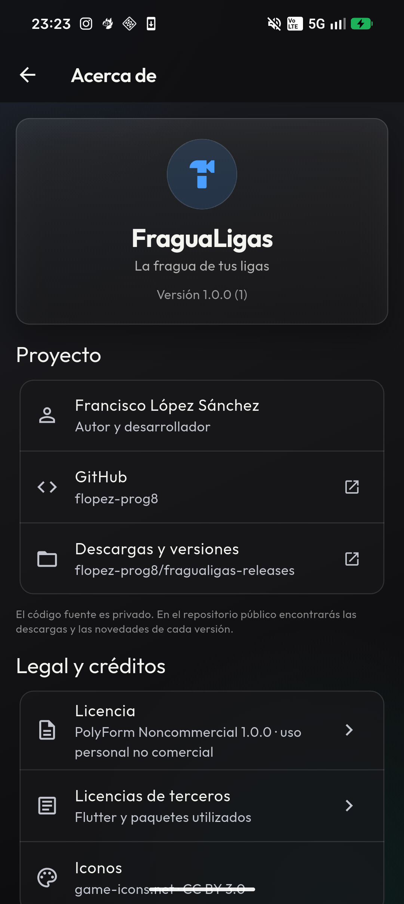

  

<h1 align="center">FraguaLigas</h1>

  <strong>La fragua de tus ligas.</strong> 
  Crea, organiza y juega ligas y torneos de cartas, con ranking, historial y contador de vidas.

  <a href="https://github.com/flopez-prog8/fragualigas-releases/releases/latest">Descargar APK</a>
  ·
  <a href="https://github.com/flopez-prog8">GitHub</a>

## Qué es

FraguaLigas es una app Android para organizar ligas y torneos round robin de Magic: The Gathering, aunque sirve para cualquier juego de cartas. Combina ligas locales guardadas en el teléfono con ligas online compartidas a través de Supabase.

- Ligas locales con jugadores, emparejamientos automáticos, resultados y clasificación.
- Ligas online con temporadas, invitaciones por código, avisos y resultados en tiempo real.
- Contador de vidas para 2–5 jugadores, con modos libre y torneo, veneno, comandante y fondos personalizados.
- Estadísticas, historial de partidas, rachas y cruces entre jugadores.
- Cuatro temas visuales: Magic, Medieval, Valhalla y Arcane, con variantes de color.
- Actualizaciones dentro de la app desde GitHub Releases.

## Capturas

  
  

## Stack

- **Flutter / Dart** para Android.
- **SQLite** con `sqflite` para los datos locales.
- **Supabase** para autenticación, ligas online, RLS y realtime.
- **Google Sign-In** para el acceso con Google.
- **GitHub Releases** para distribuir el APK y publicar actualizaciones.

## Estado

Proyecto personal en desarrollo activo. El código fuente es privado; este
repositorio es la presentación pública y el punto de descarga.

## Autor

**Francisco López Sánchez** · [github.com/flopez-prog8](https://github.com/flopez-prog8)

## Licencia

[PolyForm Noncommercial 1.0.0](https://polyformproject.org/licenses/noncommercial/1.0.0).
Uso personal y no comercial; no se permite venderlo ni explotarlo comercialmente.

© 2026 Francisco López Sánchez.

## Aviso

FraguaLigas es un proyecto personal no oficial y no está afiliado a Wizards of
the Coast. Magic: The Gathering es una marca de Wizards of the Coast. Los iconos
de color son de [game-icons.net](https://game-icons.net) y se usan bajo CC BY 3.0.
